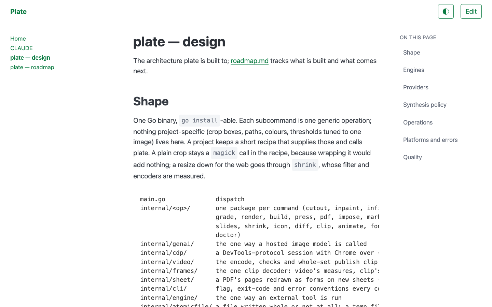

# compositor

[](https://github.com/lockyc/compositor/releases/latest)

[-CE412B?logo=rust&logoColor=white)](rust-toolchain.toml)
[](LICENSE)

Turn a folder of Markdown into a themed, navigable docs site — no config file needed. Point it at
a directory and it builds a static site with tree navigation, a contents panel per page, and
light and dark themes, or serves one with live reload. On a local `serve` you can edit any
paragraph in place, and it saves back to the `.md`. An MkDocs replacement that needs no
`mkdocs.yml`; its render engine is also a Rust library.



## Install

Each [release](https://github.com/lockyc/compositor/releases/latest) ships a prebuilt
`x86_64-unknown-linux-gnu` binary and its `.sha256`, with no runtime dependencies. Everywhere
else, build from source (compositor is developed on macOS):

```sh
cargo install --git https://github.com/lockyc/compositor compositor
```

## Usage

```sh
compositor build --dir path/to/docs-repo           # render to <dir>/site
compositor serve --dir path/to/docs-repo --open    # live-reload dev server
```

- **`build`** renders the docs tree to static HTML. It is strict: an internal link that doesn't
  resolve, or an image whose file isn't there, fails the build. `--lenient` publishes anyway,
  rendering either as a 404, and skips with a warning a page it can't read.
- **`serve`** watches the tree, rebuilds in memory on every change and refreshes open browser
  tabs. It is always lenient. `--dir` defaults to `.` and `--host` to `127.0.0.1`; omit `--port`
  and the OS picks a free one, printed on start. A loopback-bound `serve` answers only requests
  addressed to a loopback host, so to reach it through a proxy under another name, bind a
  non-loopback `--host`.
- **Edit in place.** On a loopback `serve`, a topbar toggle turns the site into an editor: click
  a paragraph, heading, list, table or code block and edit it as rendered. Changes autosave to
  the source `.md` and only the blocks you touch are rewritten. If the file changes on disk while
  you're editing, the save is refused rather than overwriting it, and your edit stays on screen
  to copy. Editing is never present in `build` output.

## What you get

- A [Pico.css](https://picocss.com) shell: top bar, a persisted light/dark toggle, a collapsible
  tree nav that opens to the current page, a per-page contents panel with scroll-spy, prev/next
  links and a footer.
- GitHub-flavoured Markdown with syntax-highlighted code.
- MkDocs-style `!!!` admonitions, `???` collapsibles and explicit heading ids
  (`## Heading {#id}`).
- `[[wikilinks]]` resolved by title, filename, alias or path, with `[[Page#id]]` deep links;
  frontmatter `title` and `aliases`.
- `.md` → `.html` link rewriting, with images resolved against the page that references them, and
  every other asset copied through.
- A repo-root `README.md` as Home, and `CLAUDE.md` / `AGENTS.md` as top-level nav entries when
  the docs live in a subdirectory.
- **As a library**, the `render-core` crate turns a Markdown tree into an in-memory site model,
  and compositor's `serve_handle` runs a site on a loopback port for a host app supervising many
  sites in one process, as [lector](https://github.com/lockyc/lector) does.

## Configuration

A `compositor.toml` in `--dir` is optional. Without one, `site_name` comes from the folder name
and the docs from `docs/` if it exists, else the directory itself. In a `compositor.toml`, an
unknown key or a syntax or type error fails the run.

| Key | Default | What it does |
|---|---|---|
| `site_name` | *required* when the file exists | Site title in the top bar and `<title>` |
| `docs_dir` | `docs` | Docs tree to render, relative to `--dir` |
| `out_dir` | `site` | Where `build` writes the rendered site |
| `exclude` | `[]` | Docs-dir-relative path prefixes to skip, e.g. `["superpowers/"]` for a directory you keep in git but don't publish |
| `surface_claude_md` | `true` | Show a repo-root `CLAUDE.md` as a top-level nav entry |
| `surface_agents_md` | `true` | Show a repo-root `AGENTS.md` as a top-level nav entry (hidden when it's identical to `CLAUDE.md`) |

Paths the repo's own `.gitignore` files ignore are skipped everywhere — rendering, asset copy,
and `serve`'s watcher. `out_dir` must not be or contain the project or docs dir, and an existing
one must be empty or a previous compositor build; a failed build leaves the previous site in
place. A symlinked file is published only when its target is inside the repo, and nothing under
`.git` is ever published or served.

## Limits

- **No site search.**
- **No `mkdocs.yml`** and no explicit nav ordering: the nav follows the docs tree.
- **Filenames with spaces** produce spaces in URLs, where MkDocs slugifies them.
- **Raw HTML renders as-is**, as in MkDocs: build only content you trust.

## Status

In use, `0.x`. The rendering is stable; the CLI and `compositor.toml` may still change. What's
next: [docs/FOLLOWUPS.md](docs/FOLLOWUPS.md).

## Development

```sh
git clone https://github.com/lockyc/compositor && cd compositor
just build    # cargo build
just test     # cargo test + the editor.js Node harness
just gate     # fmt-check + clippy + cargo test + the Node harness
```

The render surface in full, the code that owns each feature, the branch model and the release
process: [CLAUDE.md](CLAUDE.md).

## License

MIT — see [LICENSE](LICENSE).
